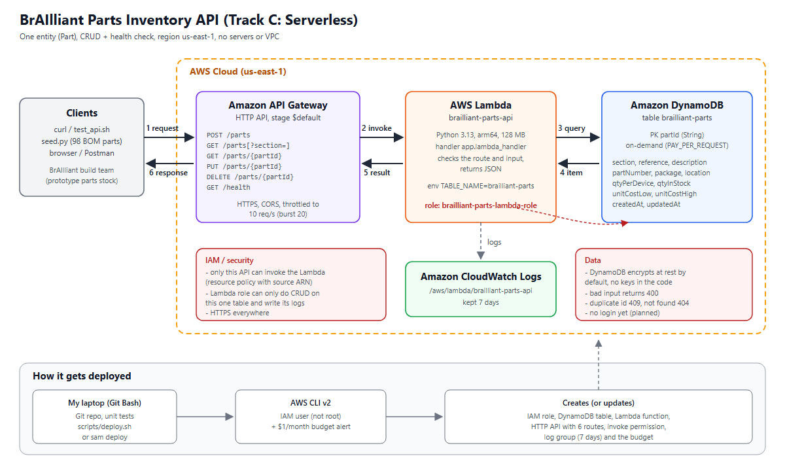

# BrAIlliant Parts Inventory API

Cloud Computing project (Week 12), Track C: API Gateway + Lambda + DynamoDB.

Muhammad Fachry Alfareeza, 540199

For the AAKRUTI competition I'm building BrAIlliant, a cheap multiline braille display.
One prototype needs 98 different parts, and so far we've tracked them in an Excel sheet.
This project is a small REST API to keep that inventory in the cloud instead: add parts,
look them up, update the stock, and delete them. The 98 parts in `data/parts.json` come
from our real BOM.



## Status

My AWS accounts (personal and AWS Academy) were suspended on 24 Nov 2026, so I couldn't
deploy to AWS yet. Instead I ran the same template locally with AWS SAM CLI and DynamoDB Local.
The API test passes and all 98 parts load. The screenshots are in [evidence/](evidence/evidence.pdf).

## Folders

```
src/app.py          the Lambda function (all CRUD logic)
tests/              unit tests, use a fake table so they run without AWS
template.yaml       SAM template (table, function, role, API)
scripts/            deploy / teardown with the AWS CLI, local run, API test, seeding
data/parts.json     98 parts from the BrAIlliant BOM
docs/               design brief, architecture diagram, deployment plan
evidence/           screenshots and test output
tools/              scripts that build the PDFs and the submission zip
```

## API

Base URL locally: `http://127.0.0.1:3000`

| Method | Path | What it does |
|---|---|---|
| POST | /parts | add a part (needs `description` and `qtyInStock`) |
| GET | /parts | list all parts, `?section=...` to filter |
| GET | /parts/{partId} | get one part |
| PUT | /parts/{partId} | change some fields of a part |
| DELETE | /parts/{partId} | delete a part |
| GET | /health | checks that Lambda can reach the table |

Example:

```bash
curl -X POST http://127.0.0.1:3000/parts -H "Content-Type: application/json" \
  -d '{"partId":"BOM-005","description":"BQ25895 charger","qtyInStock":3}'
curl http://127.0.0.1:3000/parts/BOM-005
```

## Running it

Use **Git Bash** on Windows. In PowerShell, `bash` opens WSL, which can't see Docker Desktop.

Unit tests:
```bash
python -m unittest discover -s tests -v
```

Locally (needs Docker Desktop and SAM CLI):
```bash
bash scripts/local_start.sh                        # terminal 1, keep it open
bash scripts/test_api.sh http://127.0.0.1:3000     # terminal 2
python scripts/seed.py http://127.0.0.1:3000       # load the 98 parts
bash scripts/local_stop.sh                         # when done
```

I installed SAM CLI in a venv because I don't have admin rights for the installer:
`python -m venv .venv-sam` and then `.venv-sam/Scripts/python -m pip install aws-sam-cli`.

On AWS (once my account works). Log in with an IAM user (`aws configure`), not root:
```bash
BUDGET_EMAIL=me@example.com bash scripts/deploy.sh
bash scripts/test_api.sh
bash scripts/teardown.sh                           # after grading
```
Or with SAM: `sam build && sam deploy --guided`.

## Cost

Everything is pay-per-request, so it costs nothing when nobody uses it. There's no EC2 or RDS
running by the hour. I also throttled the API to 10 requests/second, kept the logs for only 7 days,
and set a $1/month budget alert.
